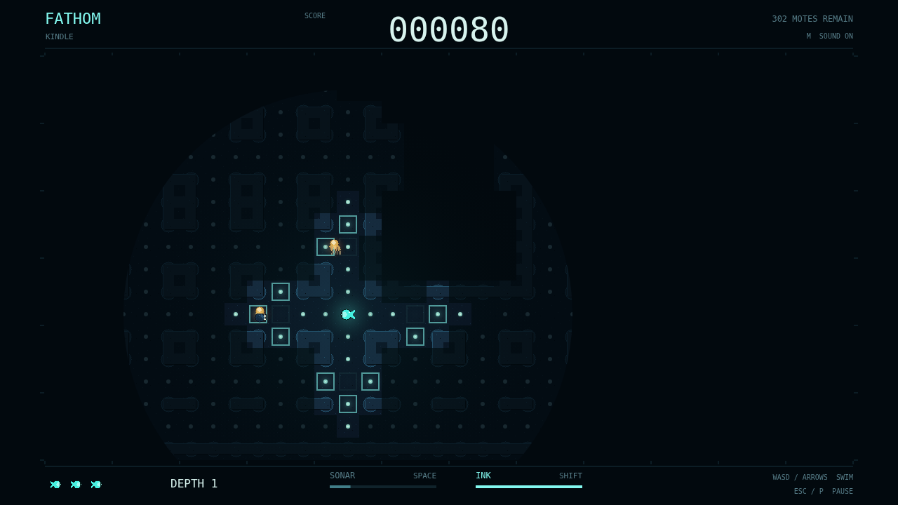

# Fathom

Your light is a lifeline. And a lure. Slip into a flooded labyrinth as a tiny
bioluminescent forager, gathering the pinpricks of plankton that hang in the
water. Each mouthful makes you brighter, opening a wider window into the dark
while advertising your presence to something hungry.

Sonar spills around corners and through junctions, sketching passages into
memory. What you explored stays with you, but only inside the circle of water
you can still see. A pulse can expose a hunter far beyond your glow—and tell a
listening hunter exactly where to look.

Three predators make every glimmer a question. The Lanternjaw follows your
light beneath a bell that looks just like a harmless drifter. The Gloamfin hunts
by sound, gaining on straightaways and losing its edge at corners. The
Flarefish's warning glow swells into a flash that sees straight through rock.
Ink buys breathing room against eyes, but not ears.

Eat the last mote and descend. The next maze brings more hunters and less sonar
reach, with your score and remaining lives riding along. Stay bright enough to
find a way, quiet enough to keep it, and never trust an amber light.

